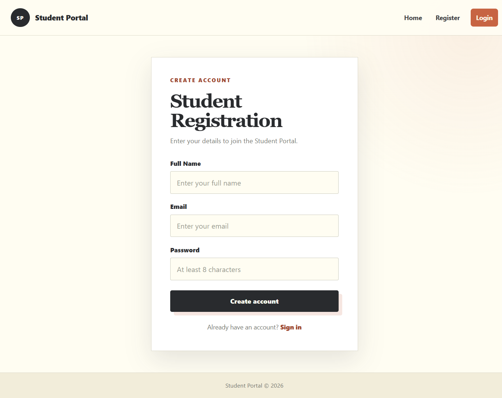
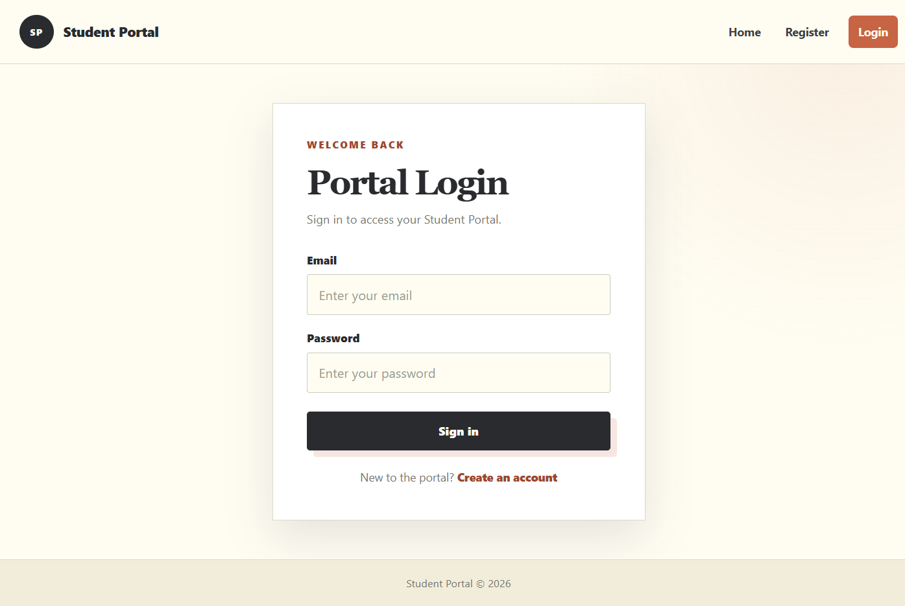
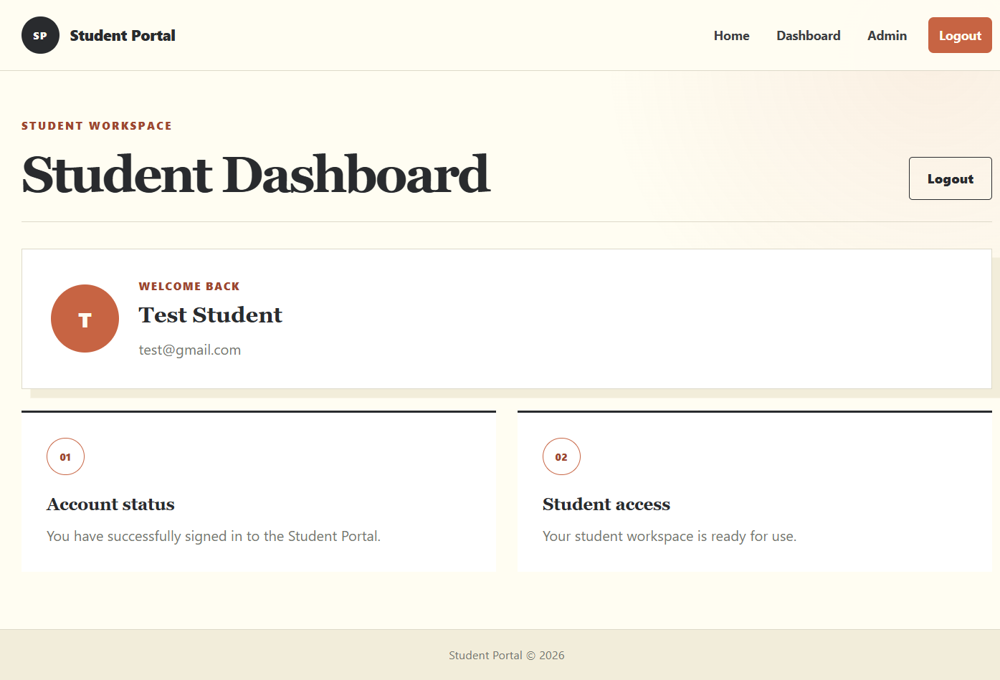

# Student Portal

A server-rendered Student Portal built using **FastAPI, Python, SQLAlchemy, SQLite, and Jinja2**. The application implements session-based authentication, secure password hashing, protected routes, and role-based access control for students and administrators.

## Features

### Authentication

- Student registration with full name, email, and password.
- Secure password hashing using Argon2 through `pwdlib`.
- Login with password verification.
- Session-based authentication using Starlette `SessionMiddleware`.
- Logout functionality with session clearing.

### Student Dashboard

- Protected student dashboard.
- Only authenticated users can access the dashboard.
- Displays the logged-in user's information.

### Admin Dashboard

- Separate admin dashboard.
- Role-based access control.
- Student accounts are restricted from accessing admin routes.
- Unauthorized student access returns HTTP 403 Forbidden.

### Frontend

- Server-rendered HTML using Jinja2 templates.
- Jinja2 template inheritance.
- Custom cream, charcoal, and terracotta CSS styling.
- FastAPI static file handling.

## Technology Stack

| Technology | Purpose |
| --- | --- |
| Python | Backend programming |
| FastAPI | Web framework |
| SQLAlchemy | ORM and database operations |
| SQLite | Database |
| Jinja2 | HTML templating |
| pwdlib + Argon2 | Password hashing and verification |
| Starlette SessionMiddleware | Session-based authentication |
| HTML5 | Frontend structure |
| CSS3 | Frontend styling |

## Project Structure

```text
student-portal/
├── static/
│   └── css/
│       └── style.css
├── screenshots/
├── templates/
│   ├── base.html
│   ├── home.html
│   ├── register.html
│   ├── login.html
│   ├── dashboard.html
│   └── admin.html
├── main.py
├── database.py
├── models.py
├── security.py
├── make_admin.py
├── requirements.txt
├── .env.example
├── .gitignore
└── README.md
```

## Installation and Setup

### 1. Clone the repository

```bash
git clone https://github.com/MokshithRao/student-portal.git
```

Navigate into the project directory:

```bash
cd student-portal
```

### 2. Create a virtual environment

```bash
python -m venv venv
```

Activate the virtual environment on Windows PowerShell:

```powershell
.\venv\Scripts\Activate.ps1
```

### 3. Install dependencies

```bash
pip install -r requirements.txt
```

### 4. Configure environment variables

Create a `.env` file in the project root using `.env.example` as a reference.

```env
DATABASE_URL=sqlite:///./student_portal.db
SECRET_KEY=your_random_secret_key
```

Generate a secure secret key using:

```bash
python -c "import secrets; print(secrets.token_hex(32))"
```

Replace the placeholder with the generated key.

**Important:** Never commit your actual `.env` file or expose your secret key publicly.

### 5. Run the application

```bash
uvicorn main:app --reload
```

Open `http://127.0.0.1:8000/` in your browser.

## Application Routes

| Route | Method | Description | Access |
| --- | --- | --- | --- |
| `/` | GET | Home page | Public |
| `/register` | GET | Registration page | Public |
| `/register` | POST | Register a student | Public |
| `/login` | GET | Login page | Public |
| `/login` | POST | Authenticate user | Public |
| `/dashboard` | GET | Student dashboard | Authenticated users |
| `/admin` | GET | Admin dashboard | Admin only |
| `/logout` | GET | Logout and clear session | Authenticated users |

## Authentication and Authorization

### Registration

1. The user submits their name, email, and password.
2. The backend validates the submitted information.
3. It checks whether the email is already registered.
4. The password is hashed using Argon2.
5. User information is stored in the SQLite database.
6. New accounts are automatically assigned the `student` role.

### Login

1. The user submits an email and password.
2. The backend retrieves the user using their email.
3. The entered password is verified against the stored Argon2 hash.
4. On successful authentication, the application stores the user's ID in the session.
5. Users are redirected according to their assigned role.

### Role-Based Access Control

- Students can access the Student Dashboard.
- Administrators can access the Admin Dashboard.
- Students attempting to access `/admin` receive HTTP 403 Forbidden.
- Unauthenticated users are redirected to the login page.
- Public registration does not allow users to assign themselves an administrator role.

## Database Schema

### Users Table

| Column | Description |
| --- | --- |
| `id` | Primary key |
| `name` | Full name |
| `email` | Unique email address |
| `password_hash` | Argon2 password hash |
| `role` | User role (`student` or `admin`) |

## Screenshots

### Home Page


### Student Registration



### Student Login



### Student Dashboard



### Admin Dashboard


### Student Access Restriction for the Admin Route

When a student is logged in and attempts to access `/admin`, the application returns HTTP 403 Forbidden with `Access Denied`.


## Security Considerations

- Passwords are never stored in plaintext.
- Argon2 is used for password hashing.
- Password verification uses `pwdlib`'s verification method.
- Only the user ID is stored in the session.
- Session secrets are loaded from environment variables.
- Public registration assigns the student role by default.
- Protected routes verify authentication and authorization.

**Note:** This is an educational project. Additional security measures, including CSRF protection, HTTPS configuration, and a production security review, are required before public deployment.

## Future Enhancements

- Student profile management.
- Student CRUD operations.
- Admin student management.
- Improved dashboard functionality.
- Additional input validation and security enhancements.

## Author

**Mokshith Rao**

GitHub: [MokshithRao](https://github.com/MokshithRao)

---

Built as a learning project to understand FastAPI, SQLAlchemy ORM, session-based authentication, password security, and role-based access control.
