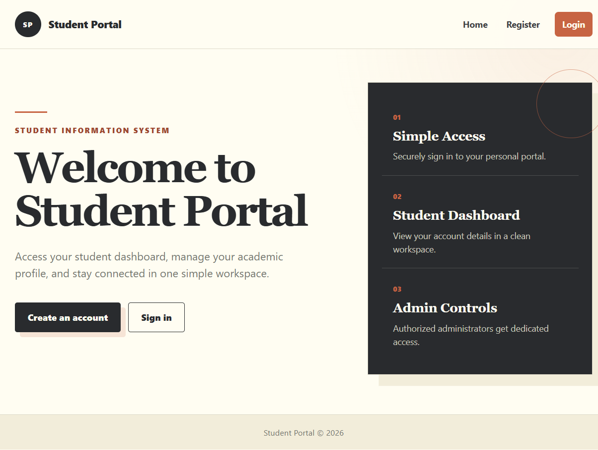
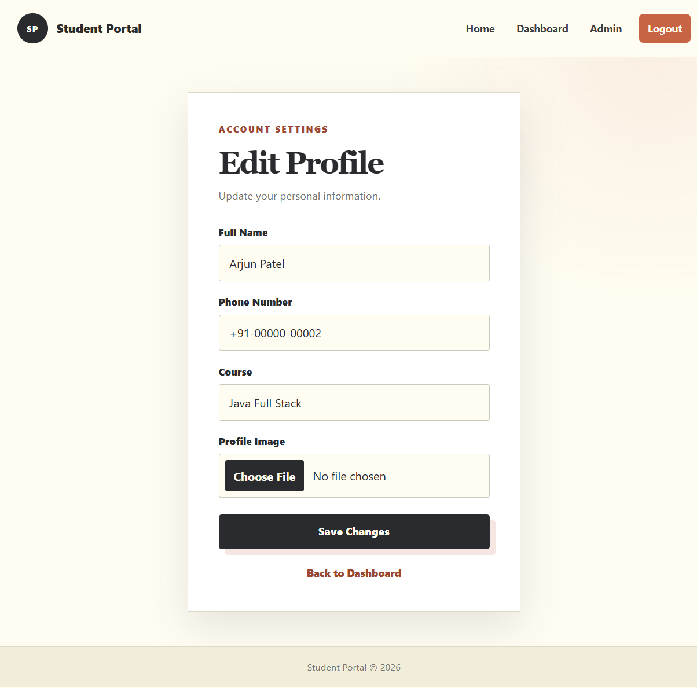
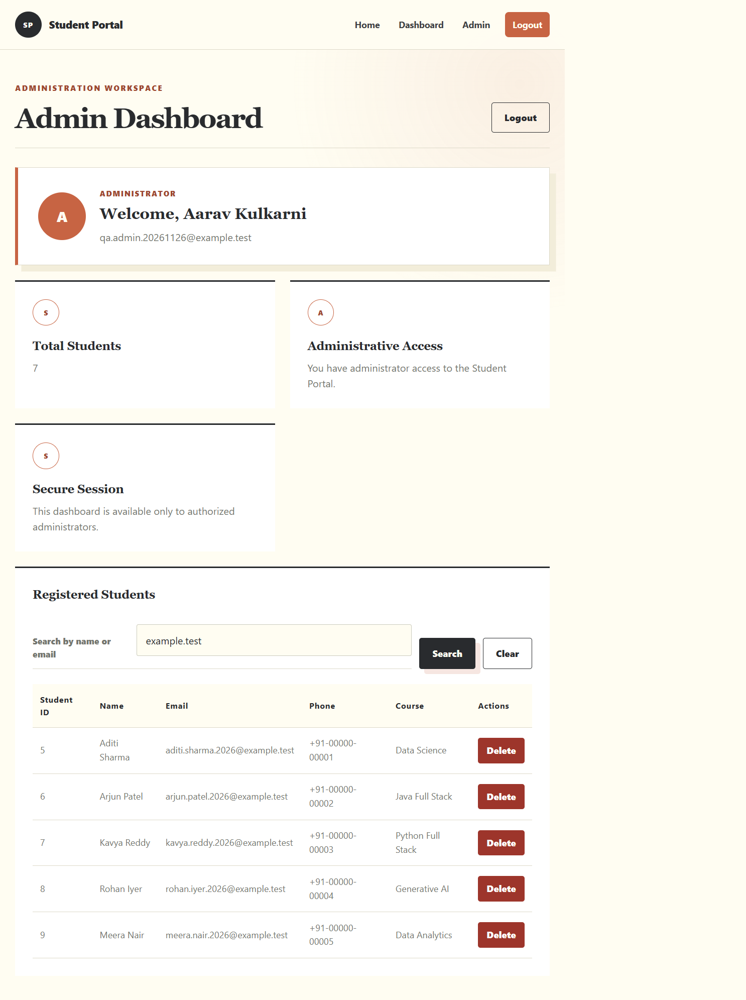
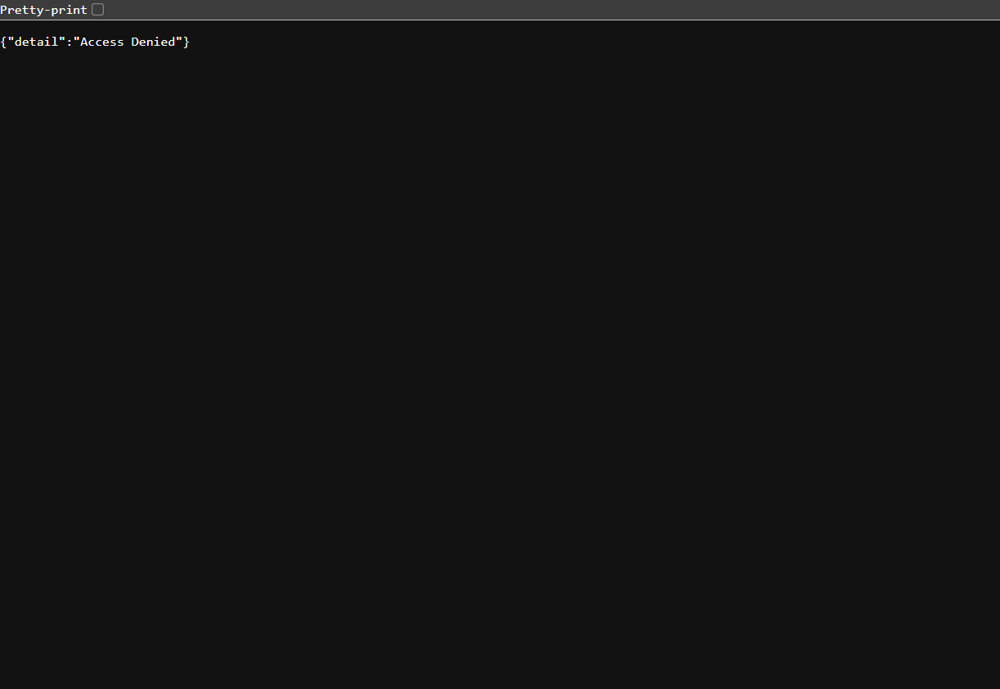

# Student Portal

A server-rendered student portal built with FastAPI, SQLAlchemy, SQLite, and Jinja2. Students can register, sign in, view and edit their profiles, and upload profile images. Administrators can search for and delete student accounts.

## Features

### Student accounts

- Public registration creates student accounts only.
- Email addresses are trimmed and stored in lowercase; duplicate checks are case-insensitive.
- Passwords must contain at least eight characters and are hashed with `pwdlib`.
- Session-based login redirects students to their dashboard and administrators to the admin dashboard.
- Students can view their details and update their name, phone number, course, and optional profile image.
- Profile images accept JPEG, PNG, and WEBP files up to 2 MB. Replaced images are removed when no other account references them.

### Administrator tools

- The admin dashboard lists student accounts and shows the total number of registered students.
- Search matches student names and email addresses. The displayed total remains the count of all students.
- Administrators can delete student accounts; the search is retained after deletion.
- Students who try to access the admin dashboard receive HTTP 403.

## Technology

- Python
- FastAPI and Starlette sessions
- SQLAlchemy ORM
- SQLite
- Jinja2 templates
- `pwdlib` password hashing
- HTML and CSS

## Project layout

```text
student-portal/
├── main.py                 # Routes and application setup
├── database.py             # SQLite engine, session, and ORM base
├── models.py               # User model
├── security.py             # Password hashing and verification
├── create_admin.py         # Interactive administrator account setup
├── requirements.txt
├── .env.example
├── static/
│   ├── css/style.css
│   └── uploads/             # Uploaded profile images
├── templates/               # Jinja2 pages
└── screenshots/             # Current application screenshots
```

## Run locally

1. Create and activate a virtual environment:

   ```powershell
   python -m venv venv
   .\venv\Scripts\Activate.ps1
   ```

2. Install the project requirements:

   ```powershell
   pip install -r requirements.txt
   ```

3. Copy `.env.example` to `.env` and set a private session secret:

   ```env
   DATABASE_URL=sqlite:///./student_portal.db
   SECRET_KEY=replace_with_a_long_random_value
   ```

   Generate a secret with:

   ```powershell
   python -c "import secrets; print(secrets.token_hex(32))"
   ```

4. Start the application:

   ```powershell
   uvicorn main:app --reload
   ```

   On startup, `main.py` creates the SQLite database tables if they do not already exist. Open <http://127.0.0.1:8000/>.

5. To create an administrator, keep the application running and use a second terminal in the project directory:

   ```powershell
   .\venv\Scripts\Activate.ps1
   python create_admin.py
   ```

   Enter the administrator's name, email, phone, department, and password when prompted. Public registration always creates a student account.

## Application routes

| Method | Path | Purpose | Access |
| --- | --- | --- | --- |
| `GET` | `/` | Home page | Public |
| `GET` | `/register` | Registration form | Public |
| `POST` | `/register` | Create a student account | Public |
| `GET` | `/login` | Login form | Public |
| `POST` | `/login` | Authenticate and start a session | Public |
| `GET` | `/dashboard` | View student details | Student |
| `GET` | `/edit-profile` | Show the profile form | Student |
| `POST` | `/edit-profile` | Update profile details and optional image | Student |
| `GET` | `/admin` | View and search student accounts (`?q=...`) | Admin |
| `POST` | `/admin/students/{student_id}/delete` | Delete a student and retain the search term | Admin |
| `GET` | `/logout` | Clear the current session | Any visitor |

Unauthenticated requests to protected pages redirect to `/login`. A user with the wrong role receives HTTP 403.

## Database

The `users` table contains:

| Column | Description |
| --- | --- |
| `id` | Primary key |
| `name` | User's name |
| `email` | Unique email address |
| `password_hash` | Hashed password |
| `role` | `student` or `admin` |
| `phone` | Phone number |
| `course` | Student course or admin department |
| `profile_image` | Optional path to a profile image |

The default database URL stores data in `student_portal.db` in the project directory. Keep a backup before manually changing database contents. The database file is excluded from Git.

## Screenshots

The screenshots below show the current application pages.

### Home



### Registration


### Login


### Student dashboard


### Edit profile



### Admin dashboard



### Student access restriction



## Security notes

- Passwords are hashed; plaintext passwords are not stored.
- The session secret is read from `.env`. Do not commit `.env` or share its secret.
- Public registration does not allow assigning the administrator role.
- The session cookie is configured for local development. Before public deployment, configure HTTPS and review session-cookie settings, CSRF protection, and upload handling for the deployment environment.

This is an academic project and is intended for local learning and demonstration.
